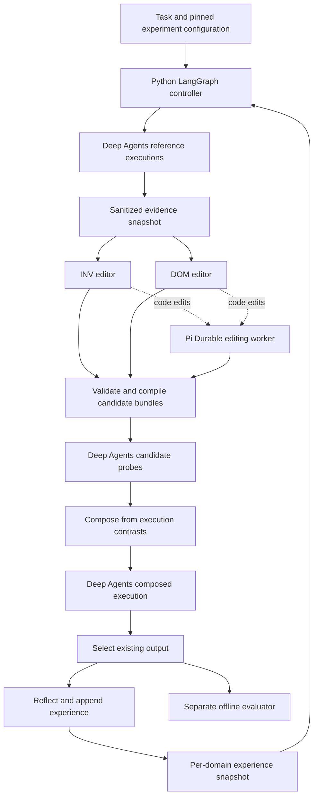

# Harness² with Deep Agents, Fireworks DeepSeek V4.1 Flash, and Pi Durable

Research and proposal — 21 October 2026. Status: proposed architecture; no implementation or paid model calls performed.

## Recommendation and scope

Build a Python system with an explicit LangGraph workflow around Deep Agents executors. Use `accounts/fireworks/models/deepseek-v4p1-flash` for all agent roles initially. Host Pi Durable in a small TypeScript worker for proposals that edit executable harness components. Store immutable candidate bundles, execution evidence, and per-domain experience separately from conversational checkpoints.

The intended outcome is a functional reproduction of Harness²'s two recursion levels with different execution and editing substrates. It is not a promise to reproduce Google's benchmark scores. Assume an initial local CLI and container-based execution, followed by benchmark adapters. No UI, hosted service, fine-tuning, or unrestricted modification of the controller is required for the first version.

A faithful research profile should preserve the original schedule and adoption rules. A separate practical profile can permit baseline retention and bounded early stopping. Every result must record which profile ran.

## Evidence inspected

The workspace was empty. Repository sources were read through the connected GitHub integration; documentation and model information were checked online.

| Source | Snapshot inspected |
|---|---|
| Harness² | `1cfe254e8d25b15f37048c3730134686abe60335` |
| Deep Agents | `4251519a9e2244e8ed3996107efe4d30bbd6d9b4`; source package version `0.7.29` |
| Pi | Main-branch materials and commit `4759f09fbcc1c62805d23c7a20ec40b1b1361e95`; Durable package manifest version `1.3.0` |

Pin published package versions and all transitive dependencies during implementation. Main-branch source versions are research observations, not a tested dependency set. Some Pi files were read from main before its exact commit was resolved; resolve all build inputs to one snapshot before developing the worker.

## What Harness² actually does

Harness² optimizes the system surrounding a fixed model. The release separates benchmark adapters, executor substrates, editable harness trees, improvement sessions, recursion scheduling, selection, reflection, and reporting. Its core interfaces are a useful starting point for our design. [Substrate interface](https://github.com/google-research/harness2/blob/1cfe254e8d25b15f37048c3730134686abe60335/harness2/substrate/base.py), [benchmark contracts](https://github.com/google-research/harness2/blob/1cfe254e8d25b15f37048c3730134686abe60335/harness2/core/spec.py).

Task-level refinement has three operations:

1. **Propose:** independent editors produce INV edits addressing general execution procedure and DOM edits addressing practitioner knowledge and domain checks.
2. **Probe:** execute each candidate on the same task under matched model and environment settings. Collect trajectories and actual deliverables.
3. **Compose:** inspect changes and their behavioral consequences; selectively merge, revise, adopt, or preserve the current harness. Execute the composed result.

This is evidence-informed search without ground-truth feedback during refinement. Behavioral improvement is not proof of correctness. [Paper, method section](https://arxiv.org/html/2610.14224v1#S2).

### Recursion budgets

| Mode | References | Candidate probes | Composed executions | Editing/composition sessions |
|---|---:|---:|---:|---:|
| Parallel, budget k | k | k INV + k DOM | k | 3k |
| Sequential, budget k | k | 2 per round, k rounds | 1 per round | 3k |

Thus each mode accounts for **4k task executions**, before retries. The improvement sessions are agent runs that can each make many LLM calls. Selection and reflection are additional work. When both modes run together, references can be shared; do not double-count those references in aggregate costs. [Recursion implementation](https://github.com/google-research/harness2/blob/1cfe254e8d25b15f37048c3730134686abe60335/harness2/core/recursion.py).

Parallel mode widens search from shared evidence. Sequential mode edits the current harness while retaining original references and previous candidates/checkpoints as evidence. Neither is equivalent to calling a critique tool repeatedly.

### Selection and cross-task learning

The published selector chooses an existing deliverable from the k composed outputs, including intermediate composed checkpoints in sequential mode. Baseline and raw INV/DOM outputs are excluded from the normal selection pool. At k=1 under the finals policy, selection is trivial. Composition can preserve the baseline harness, but its resulting execution is still a composed candidate. [Selection source](https://github.com/google-research/harness2/blob/1cfe254e8d25b15f37048c3730134686abe60335/harness2/core/selection.py).

After adoption, reflection records an applicable cue, a transferable lesson, supporting evidence, and optional confidence/edit notes. The library retains the complete adopted component tree. Entries are scoped to the experiment and domain; tasks consume earlier entries in stream order. Subsequent tasks start from the configured base harness and use earlier experiences to guide editing; the system does not simply replace the base globally with the previous winner. [Library source](https://github.com/google-research/harness2/blob/1cfe254e8d25b15f37048c3730134686abe60335/harness2/core/library.py), [scheduler source](https://github.com/google-research/harness2/blob/1cfe254e8d25b15f37048c3730134686abe60335/harness2/core/schedule.py).

### Editable surface and validation

There are eight component categories: system prompt, guardrails, memory, tool guidance, subagents, skills, scripts, and plugins. Files are inherited unless edited or removed. Validation restricts paths, checks always-on context limits, skill metadata/discoverability, script syntax and references, and substrate-specific structures. An invalid proposal receives a repair attempt before fallback. [Tree validation](https://github.com/google-research/harness2/blob/1cfe254e8d25b15f37048c3730134686abe60335/harness2/core/tree.py).

The evidence builder withholds grader material and checks for known leakage markers. These checks need an infrastructure boundary as well: upstream documents unrestricted executor networking and an observed rubric download. [Evidence builder](https://github.com/google-research/harness2/blob/1cfe254e8d25b15f37048c3730134686abe60335/harness2/core/context.py), [experiment guide](https://github.com/google-research/harness2/blob/1cfe254e8d25b15f37048c3730134686abe60335/docs/EXPERIMENTS.md).

## Three implementation approaches

| Approach | Advantages | Trade-offs |
|---|---|---|
| **New controller with Deep Agents executor and Pi editor — recommended** | Clear runtime ownership; native editable bundle; independent practical/research policies | Must reproduce scheduling and evidence semantics carefully |
| Extend upstream Harness² with new executor and improver adapters | Strongest route to direct parity; can reuse benchmark infrastructure | Existing improver channels and installation assumptions need changes; a substrate adapter alone is insufficient |
| One autonomous Deep Agent drives all refinement | Fast prototype and little controller code | Weak control over budgets, isolation, scheduling, and reproducibility |

Use upstream as a reference and selectively reuse compatible adapter/validation code with Apache-2.0 attribution. Maintain a small parity fixture against upstream schedules. Avoid copying its executor installation machinery into our core. Inspect benchmark licenses independently before redistributing data or derived assets.

## Proposed architecture



The controller owns experiment state, budgets, stage transitions, and adoption. Deep Agents owns tool-using task execution. Pi owns only the durable editing job assigned to it. The evaluator reads completed artifacts through a separate process and storage namespace; its scores do not flow into the online refinement graph.

### Component mapping

| Harness component | Deep Agents implementation |
|---|---|
| System prompt | Bundle text passed to `create_deep_agent(system_prompt=...)` |
| Guardrails | Editable task-behavior guidance plus selected middleware settings; fixed operational policy remains outside the bundle |
| Memory | Bundle-scoped files loaded through `memory=`; runtime writes go to a private overlay |
| Tool guidance | Versioned tool descriptions; supported profile overrides or tool wrappers, with contract checks |
| Subagents | Compile declarative definitions into `subagents=`; explicitly use the same Fireworks model |
| Skills | Versioned SKILL.md directories exposed through `skills=` and the backend |
| Scripts | Candidate-local executables inside the rollout sandbox |
| Plugins | Validated Python middleware modules, loaded only in isolated workers |

Deep Agents exposes these building blocks, including backend, middleware, memory, skills, subagents, checkpointer, and store parameters. Pin a harness profile so implicit model-specific defaults cannot change between candidates. Do not mutate process-global profile registrations concurrently. [Graph assembly source](https://github.com/langchain-ai/deepagents/blob/4251519a9e2244e8ed3996107efe4d30bbd6d9b4/libs/deepagents/deepagents/graph.py).

Use a fresh compiled executor, thread ID, sandbox, and memory overlay for every rollout. Freeze the candidate version through the whole rollout, including delegated subagents. Ordinary task delegation must not grant access to the improvement controller.

### Candidate bundle and compiler

Proposed bundle structure:

```text
manifest.json
system.md
guardrails.md
memory/AGENTS.md
tools/descriptions.json
subagents/<name>.json
skills/<name>/SKILL.md
scripts/<name>.py
middleware/<name>.py
```

The manifest records schema version, parent hash, model/configuration hash, enabled components, runtime/profile versions, and provenance. Tool guidance modifies descriptions without silently changing argument schemas or tool permissions.

The compiler validates paths and symlinks, schemas, skill references, prompt size, allowed imports and entrypoints, and script syntax. Import checks run in a disposable worker. Static checks are not a security boundary; executable plugins receive a constrained environment. A code-bearing candidate gets a new worker process and never imports into the controller.

Use explicit additions, modifications, and deletions relative to a parent digest, then materialize a full immutable tree. Record KEEP_BASE separately from validation or transport failure. One bounded repair attempt is a reasonable parity default. Preserve rejected diffs and diagnostic evidence.

### Execution and data storage

Use Linux containers for rollouts and editing jobs, including when developing on macOS. Build a sandbox backend supporting both file operations and execution; a virtual filesystem alone does not provide a real execution environment. Composite routing is useful for private scratch space and read-only bundle files, but shell access must enforce equivalent boundaries at mounts and the OS layer. [Deep Agents backends](https://docs.langchain.com/oss/python/deepagents/backends).

For the first version, use SQLite for controller/checkpoint metadata and local content-addressed artifact directories. Pi uses its own Durable SQLite storage with one writer per storage instance. A future multi-worker deployment can use PostgreSQL and object storage without changing candidate/evidence contracts.

Persist these records: ExperimentConfig, TaskSpec, HarnessVersion, EditProposal, ExecutionRecord, EvidenceSnapshot, SelectionRecord, ExperienceEntry, and BudgetLedger. Execution records include delivery status, artifact hashes, tool events, usage, environment image digest, and error category. Keep raw traces plus bounded evidence views.

Model/provider settings, prompt/profile versions, task inputs, environment, library snapshot, and execution draw identity belong in cache keys. Identical harness hashes do not justify deduplicating independently budgeted stochastic rollouts. Resume completed stages from verified records; never treat a partial artifact as a completed execution.

## Fireworks integration

The exact requested model is listed as ready and available through serverless inference. The live model page lists **$0.30 input / $0.006 cached input / $1.20 output per million tokens** and approximately 1040k context. These are observed published rates, not a quotation or account-specific guarantee. Search-index snippets showed older prices; use current billing information before a run. The page also contains contradictory fine-tuning descriptions, which are irrelevant because this design keeps weights fixed. [Live model page](https://fireworks.ai/models/deepseek-ai/deepseek-v4p1-flash).

Use native `langchain-fireworks` first. The provider-form model string is:

```text
fireworks:accounts/fireworks/models/deepseek-v4p1-flash
```

An explicit `ChatFireworks` instance provides clear timeout, retry, output-limit, and reasoning configuration. Supply the model explicitly to every model-bearing role and middleware path; audit summarization, selectors, reflection, and subagent defaults. [LangChain Fireworks integration](https://docs.langchain.com/oss/python/integrations/chat/fireworks).

An OpenAI-compatible adapter at `https://api.fireworks.ai/inference/v1` is a fallback if native integration fails a required compatibility check. Do not assume Responses API compatibility when using Chat Completions. [Fireworks text API](https://docs.fireworks.ai/guides/querying-text-models).

Before implementing recursion, run a small paid preflight once credentials and a budget are supplied: multi-turn tool calls, tool-call IDs and errors, concurrent calls, structured manifests, streaming, usage/cached-token accounting, reasoning fields across tool turns, image input if needed, checkpoint restart, and context summarization. Reasoning controls vary by model; verify accepted settings rather than assuming every documented effort value applies. [Fireworks reasoning documentation](https://docs.fireworks.ai/guides/reasoning).

Start with explicit bounded output and total task-token limits. Tune context compaction using measured consumption rather than filling the advertised maximum. Persist provider compatibility results as part of the experiment configuration.

## Pi Durable for recursive self-improvement

RSI here means recursive improvement of prompts, skills, tools, and allowed harness code. It does not mean changing model weights or giving the agent authority to rewrite its evaluator and controller.

Pi Durable is well suited to resumable editing. It offers persisted conversations/tasks and an extension registry; its coding tools provide read, write, edit, and bash through a configured execution environment. Its API is explicitly experimental. [Pi Durable README](https://github.com/earendil-works/pi/blob/main/packages/durable/README.md).

Implement a small TypeScript worker using Durable plus CodingTools and a container execution environment. Use the same requested Fireworks model through pi-ai. Pi has a Fireworks provider; confirm the exact model resolves in the pinned published catalog. The source catalog data path could not be retrieved during this review, so registration of this exact ID remains unverified. If needed, supply explicit model metadata through a custom provider. [Fireworks provider source](https://github.com/earendil-works/pi/blob/4759f09fbcc1c62805d23c7a20ec40b1b1361e95/packages/ai/src/providers/fireworks.ts), [custom-provider API](https://github.com/earendil-works/pi/blob/main/packages/ai/README.md#custom-providers).

Proposed worker contract:

```text
submit(EditJob) -> job_id
status(job_id) -> persisted status and usage
result(job_id) -> candidate hash, diff, rationale, evidence references
cancel(job_id) -> terminal cancellation status
```

EditJob includes a stable request ID, parent bundle hash, evidence snapshot hash, INV/DOM/COMPOSE scope, allowed paths, and resource budget. Use local HTTP/Unix-socket RPC with artifact references. A restarted Python stage reacquires its existing job instead of submitting a duplicate. Persist submission identity before waiting; reconcile crashes between admission and controller checkpointing.

Deep Agents can handle text-only edits itself. Route executable changes to Pi and include its cost in that stage. In parity experiments use a fixed editor-routing policy rather than changing routing opportunistically between arms. Pi can also perform the full editing/composition stage when consistency is more important than minimizing worker calls.

Do not hot-reload experimental code into the Python controller. Pi's extension reload is useful inside its own runtime but is not a mechanism for publishing Deep Agents middleware. Return a candidate artifact, validate it, then launch a fresh executor process.

Durable checkpoints do not make arbitrary shell side effects exactly-once. Use disposable editing directories and atomic publication by digest; reconcile or restart ambiguous shell actions. Pi's package currently requires Node >=22.19.0; select a compatible current LTS and test the SQLite storage adapter there. [Durable package manifest](https://github.com/earendil-works/pi/blob/4759f09fbcc1c62805d23c7a20ec40b1b1361e95/packages/durable/package.json).

## Experience policy and isolation

Treat conversation memory, a candidate's execution memory, and the improvement library as separate stores. Executors cannot write directly to the shared experience library. Only validated reflection records append to it after adoption. Deep Agents memory provides filesystem primitives; the controller supplies the causal ordering and provenance policy. [Deep Agents memory](https://docs.langchain.com/oss/python/deepagents/memory).

Snapshot the library before every task. Keep tasks within a domain ordered and parallelize across domains. Namespace libraries by model, executor, benchmark, profile, budget, seed, and domain. Holdout evaluation uses a frozen library; online stream evaluation may learn from earlier tasks and must be reported separately. Store full bundles and evidence pointers; an index can later support retrieval without replacing the source records.

Keep benchmark answers, private tests, grader prompts, and scores outside every agent mount and network route. Allow only task-authorized verification evidence during refinement. For repository tasks, visible project tests can inform edits; hidden evaluation tests cannot. Network policy must apply equally to Python and Pi tools. Use a model gateway or narrowly scoped credentials so candidate code cannot read a general-purpose account key.

## Faithful and practical profiles

| Policy | Research parity | Practical use |
|---|---|---|
| Schedule | Exact k references, 2k probes, k composed executions | Bounded schedule; optional early stop |
| Adoption pool | Composed outputs only | Can include baseline outputs |
| Shared experience | Prior same-domain entries | Curated approved experience; explicit provenance |
| Operational failure | Recorded distinctly; parity-compatible fallback | Return a valid baseline where available |
| Code editing | Fixed editing surface and routing | Bounded Pi changes behind validation |

An expanded selection pool may reduce forced adoption of weaker outputs, but it is not a correctness guarantee. Record every deviation from parity. Never use offline benchmark scores to decide online adoption in either profile.

## Evaluation and acceptance

First prove the mechanism with deterministic scripted editors and a small task adapter. Verify exact rollout/stage counts at k=1 and k=2, ancestry, candidate isolation, identical-task probing, repair/fallback, correct selection pool, and replay/resume behavior. This detects architectural mistakes without API costs.

Then use a proposed development pilot of roughly 20–30 tasks spanning code, structured document work, and analysis, subject to available datasets. Freeze task inputs and a domain-stratified split before tuning. This pilot diagnoses failures; it does not establish a statistically reliable improvement claim.

Compare:

1. A strong fixed Deep Agents baseline.
2. Repeated fixed-harness runs with output selection at matched total token/cost budgets.
3. Task refinement without cross-task library.
4. Full refinement with the library.
5. Full refinement with Pi-generated executable changes enabled.

After k=1 works, compare k=2 parallel and sequential with the same models, evidence access, task order, and budget accounting. Include all selector, editor, reflection, compaction, retry, and delegated-model calls in cost. Measure offline quality, delivery failures, regression frequency, wall time, cost per successful task, candidate diversity, and selector reliability. Use paired comparisons and uncertainty estimates across tasks/seeds before asserting a gain.

Acceptance requires a complete auditable k=1 task, exact research scheduling, no cross-candidate file changes, a lesson with traceable evidence, the next same-domain task consuming only earlier records, offline scores excluded from agents, and successful recovery after injected failures around Pi submission and artifact publication. Report failures to grade as missing evaluations with coverage; do not silently replace them with zero.

## Cost model

At the observed rates, estimate API cost as:

```text
USD = 0.30 * uncached_input_tokens / 1e6
    + 0.006 * cached_input_tokens / 1e6
    + 1.20 * billed_output_tokens / 1e6
```

Illustration only: a task execution consuming 200k uncached input tokens across all its requests and 20k billed output tokens costs $0.084. Four equivalent executions cost $0.336. Three improvement sessions at an assumed 100k input and 10k output tokens each add $0.126, for $0.462 before selection, reflection, retries, and infrastructure. These token volumes are assumptions, not measured Harness² or DeepSeek consumption. Agentic coding and repeated evidence reads can be substantially larger.

Set dollar, token, time, tool-call, delegation-depth, and repair limits. Reserve budget before scheduling a phase so one branch cannot consume the budget intended for composition. Track requested limits and actual billed usage separately. Cache benefits depend on provider behavior and should not be assumed in the initial budget.

## Delivery sequence

| Phase | Deliverable | Exit condition |
|---|---|---|
| 0: Provider and runtime check | Pinned dependencies; Fireworks and Pi compatibility results | Exact model works through both runtimes |
| 1: Execution foundation | Bundle compiler, sandbox, task adapter, traces/checkpoints | Reproducible isolated baseline execution |
| 2: Task recursion | INV/DOM/probe/compose, parity profile, deterministic fixtures | Auditable k=1 and k=2 schedules |
| 3: Cross-task learning | Reflection, full-bundle library, causal snapshots | Ordered reuse demonstrated without leakage |
| 4: Pi code editing | Durable worker, bounded code edits, idempotent RPC | Crash recovery and candidate publication verified |
| 5: Benchmark study | One upstream benchmark adapter, ablations, practical profile | Quality/cost report supports adoption decision |

A planning estimate is 4–6 focused engineering weeks for a local research MVP with one benchmark adapter, assuming container infrastructure and compatible provider behavior. Full parity across JobBench, LAB, and WorkBuddy requires a separate estimate after adapter and rendering work is scoped. Live inference checks may expose integration work that changes this estimate.

The recommended first release is a CLI, one task adapter, all eight defined component slots, k=1 recursion, per-domain experience, and Pi editing for scripts/middleware after the text-editing loop is verified. Defer a dashboard, distributed scheduling, arbitrary controller self-modification, and broad benchmark replication.

## Remaining decisions before implementation

This proposal assumes broad task support with code tasks as the easiest initial engineering validation. Choose the first real workload/benchmark and a pilot spending cap before model-backed development. Confirm whether research parity or practical adoption is the initial priority. These decisions affect adapter work and experiments, but do not prevent the proposed architecture from supporting both.

No model compatibility, throughput, cost, crash-recovery, or benchmark-performance claims have been experimentally validated in this analysis. The next step is review of this proposal, followed by a concrete implementation plan for the chosen first workload.
